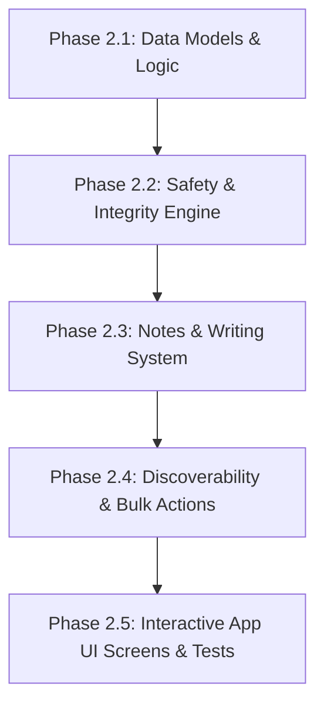

# Phase-2 Architecture & Implementation Roadmap

> **Status:** Ready for Implementation (Starting Phase-2 Execution)  
> **Guiding Principle:** 100% Backward Compatible with Phase-1. Offline-first, zero telemetry, no accounts.

---

## 1. Executive Implementation Plan

This roadmap provides exact technical specifications, data contracts, and implementation steps for Phase-2 development. When resuming work tomorrow, execute the tasks in the sequential order outlined below.



---

## 2. Technical Specifications & Data Models

### 2.1. Extended Habit Schema (Non-Breaking)
All Phase-2 fields are optional with safe defaults so Phase-1 backups and existing localStorage data load seamlessly:

```typescript
export interface Phase2Habit extends Habit {
  // Notes & Writing
  notes?: string;                     // Quick notes attached to this habit

  // Discoverability & Organization
  category?: string;                  // Optional category tag (e.g., "Health", "Study")
  orderIndex?: number;                // Custom sorting order index

  // Historical Flexibility
  isPaused?: boolean;                 // Vacation / pause flag
  pausedAt?: string | null;           // Timestamp when paused
}

// App-Wide Standalone Notes
export interface StandaloneNote {
  id: string;                         // UUID / timestamp-based
  title: string;                      // Plain text title
  content: string;                    // Markdown or plain text content
  createdAt: string;                  // ISO 8601 string
  updatedAt: string;                  // ISO 8601 string
  pinned?: boolean;                   // Pinned to top
  color?: string;                     // Accent color swatch
}
```

---

## 3. Grouped Feature Specifications

### 3.1. Notes & Writing

#### A. Per-Streak Notes
- **Description:** Allow users to record thoughts, reflections, or guidelines on a specific habit.
- **Storage:** Stored directly inside the habit object as `habit.notes`.
- **UI Requirement:** Clean multiline textarea on habit details/edit sheet with character counter and auto-saving on blur.
- **Rules:**
  - Max 1,000 characters per streak.
  - Included in JSON backups under `notes` key.
  - No cloud sync; stored locally.

#### B. Standalone Offline Notes
- **Description:** A calm, distraction-free markdown/plain text scratchpad for daily reflections, goals, or study logs.
- **Storage:** Persisted under `STORAGE_KEYS.notes = "streakflame_notes"`.
- **UI Requirement:** Minimalist notes list with instant search, creation date, pin-to-top, and a distraction-free writing card.
- **Rules:**
  - Exported alongside JSON backups under `data.notes`.
  - Offline-first with zero external dependencies.

---

### 3.2. Safety & Data Integrity

#### A. Backup Preview & Pre-Validation Dialog
- **Description:** Before restoring any backup JSON file, display an informative inspection modal rather than silently overwriting.
- **Dialog Contents:**
  - File version & export timestamp.
  - Count of streaks to be imported (`Active` vs. `Archived`).
  - Total historical completions detected.
  - Settings comparison (e.g. reminder times).
  - Safety Warning: *"Restoring will replace current streaks. Ensure you have backed up your current data."*
  - Buttons: **Confirm & Restore** or **Cancel**.

#### B. Startup Data Integrity Check & Auto-Healing
- **Function:** `verifyAndHealIntegrity(habits: Habit[], today: string): { healed: Habit[]; issuesFound: number }`
- **Integrity Rules:**
  1. **Duplicate IDs:** If two habits share the same ID, assign a new deterministic ID to the duplicate.
  2. **Streak Counter Drift:** If `currentStreak !== currentStreak(completedDates, today)`, recalculate using pure logic.
  3. **History Invariance:** Ensure `completedDates` are unique, valid `YYYY-MM-DD` strings, and chronologically sorted.
  4. **Emergency Recovery Stash:** If any corrupt streak object cannot be parsed, copy its raw JSON into `localStorage["streakflame_recovery_stash"]` so no data is ever permanently lost.

#### C. Safe Past-Day Fill-In (Historical Check-In)
- **Description:** Allow users to tick off a missed habit for yesterday or any past day within a controlled window (e.g., past 7 or 30 days).
- **Function:** `togglePastDay(habit: Habit, dateStr: string, today: string): Habit`
- **Rules:**
  - Toggle date in `completedDates`.
  - Recalculate `currentStreak`, `bestStreak`, `longestStreak`, and `lastCompletedDate` using standard deterministic rules.
  - Update calendar ratios automatically.

#### D. Automatic Rolling Local Backups
- **Description:** Keep rolling automated local backups so users have an immediate restore point if they accidentally clear data.
- **Storage:** `streakflame_autobackup_history` (stores the last 7 daily snapshots in localStorage).
- **Settings Toggle:** Optional switch in Settings: *"Automatic local snapshots (last 7 days)"*.

#### E. Optional App Lock (PIN / Biometrics)
- **Description:** Protect habits and private notes from prying eyes on shared devices.
- **Mechanism:**
  - 4-digit PIN hashed locally using SHA-256 via Web Crypto API (`crypto.subtle.digest`).
  - On Capacitor native, integrate `@capacitor/biometrics` (Fingerprint/Face Unlock).
  - Timeout: Lock immediately on app backgrounding or after 5 minutes of inactivity.

---

### 3.3. Discoverability & Scale

#### A. Instant Streak Search
- **Description:** Instant filter input on the Habits screen.
- **Matching:** Case-insensitive substring match against `habit.name`, `habit.emoji`, and `habit.notes`.

#### B. Status & Category Filters
- **Tabs / Filter Pills:**
  - `All` (Total count)
  - `Active` (Only unarchived)
  - `Starred ⭐` (High-priority habits)
  - `Archived 📦` (Completed or dormant habits)
- **Category Tags:** Filter by custom tag (e.g., `#health`, `#study`, `#work`).

#### C. Bulk Actions Mode
- **Interaction:** Long-press or "Select" button to enter multi-select mode with checkboxes.
- **Available Batch Operations:**
  - **Batch Star / Unstar**
  - **Batch Archive / Unarchive**
  - **Batch Delete** (with explicit confirmation dialog showing count).

#### D. Custom Streak Reordering
- **Mechanism:** Add `orderIndex: number` to each habit.
- **UI:** Drag-and-drop handles or "Move Up / Move Down" buttons for mobile accessibility.
- **Persistence:** Immediately saved to `streakflame_streaks`.

---

## 4. Tomorrow's Sequential Implementation Steps

When starting tomorrow, follow this step-by-step checklist:

### Step 1: Core Pure Logic ([`src/lib/habits/logic.ts`](file:///d:/daily-spark/src/lib/habits/logic.ts))
- [x] Add `togglePastDay(habit, targetDate, today)` with full streak recalculation.
- [x] Add `verifyAndHealIntegrity(habits, today)` integrity checker and auto-healer.
- [x] Add `reorderHabits(habits, sourceId, targetId)` ordering utility.
- [x] Expand [`src/lib/habits/logic.test.ts`](file:///d:/daily-spark/src/lib/habits/logic.test.ts) with unit tests for each new function.

### Step 2: Store Actions ([`src/lib/habits/store.ts`](file:///d:/daily-spark/src/lib/habits/store.ts))
- [x] Add `habitActions.togglePastDay(id, targetDate)`.
- [x] Add `habitActions.reorder(orderedIds: string[])`.
- [x] Add `habitActions.bulkArchive(ids: string[], archive: boolean)`.
- [x] Add `habitActions.bulkStar(ids: string[], star: boolean)`.
- [x] Add `habitActions.bulkDelete(ids: string[])`.
- [x] Add `habitActions.updateNotes(id: string, notes: string)`.
- [x] Add automated rolling local backup helper in store persistence.

### Step 3: Standalone Notes Store ([`src/lib/habits/notes.ts`](file:///d:/daily-spark/src/lib/habits/notes.ts))
- [x] Create `notes.ts` store with `addNote`, `updateNote`, `deleteNote`, `pinNote`, and `getNotes()`.
- [x] Add unit tests in `src/lib/habits/notes.test.ts`.

### Step 4: Verification & UI Wire-Up
- [x] Run `npm run typecheck` and `npm run test` to verify 100% test pass rate.
- [x] Wire the actions to the interactive app components or test harnesses.

---

## 5. Backward Compatibility & Test Invariants

1. **No Field Renaming:** Never rename Phase-1 keys (`id`, `name`/`title`, `emoji`, `completedDates`/`history`, `createdAt`, `currentStreak`, `bestStreak`, `isStarred`, `archivedAt`).
2. **Safe Deserialization:** Any backup missing Phase-2 fields must default to `notes: ""`, `category: undefined`, `isPaused: false`.
3. **No Network:** Phase-2 must remain strictly 100% offline. Zero remote endpoints, zero trackers.
