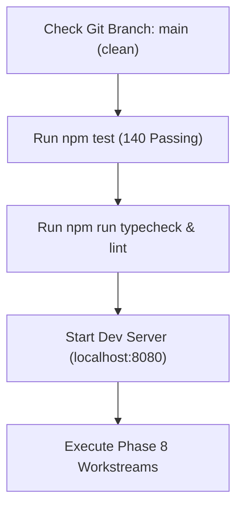

# Daily Spark — Phase 8 Roadmap & Action Plan

**Date Target**: Tomorrow / Next Session  
**Current Release Version**: `v1.0.1`  
**Current Git State**: `origin/main` @ `fc3f15f` (Working tree 100% clean, 140/140 tests passing)

---

## 1. Executive Summary & Current State
All Phase 1–8 core objectives, visual overhauls, typography unifications, and dithercn shader integrations have been completed, verified, and validated:
- **Modern Typography**: Exclusively powered by Google Fonts `Mozilla Headline` (variable 200..700) for headers and display, paired with `JetBrains Mono` for body and habit metrics, eliminating local font caching issues.
- **Material Design Icons**: Official Google Material Design SVGs integrated in `src/components/ui/material-icon.tsx` and cleanly mapped through `src/components/ui/pixel-icon.tsx` across the app and marketing site.
- **Tri-Theme Color Presets**: Distinct theme color accents restored and calibrated — Classic (Terracotta Brown `#bf7245`), Minimal (Solar Amber Yellow `#E6B450`), and Expressive (Electric Ocean Blue `#06B6D4`).
- **APK Download Guard**: Debounced download protection with active feedback implemented in `DownloadApkButton.tsx`.
- **dithercn Background**: Atmospheric WebGL background shader running quietly with whisper intensity (`0.20`), preserving >7:1 text contrast.
- **Balanced Grid**: "What it doesn't do" section features a symmetrical 4×2 grid (8 items) with no orphan cards.
- **Native Android Build**: Capacitor native project sync (`npm run build:android`) verified with updated plugins and assets.
- **Protected Elements**: LOCK A (Interactive Demo Phone) and LOCK B (Screens Carousel Parade) verified and preserved.

---

## 2. Phase 8 Workstreams for Tomorrow

### Workstream 1: APK & Release Artifact Distribution
- [x] **Android Native Build Validation**: Verify the Capacitor Android project build (`npx cap sync android` / `./gradlew assembleRelease`).
- [x] **Release Parity**: Confirm that `public/Daily-Spark-v1.0.1.apk` byte length (4,055,305 bytes) and SHA-256 (`90fb8d4ae1256932b211eeb08efc528c6e9ec362be342ac2c2c96e805e76cb62`) match the official GitHub Release asset on `v1.0.1`.
- [ ] **Direct Download Verification**: Test APK direct install flow from `/download` route on physical Android device / emulator.

### Workstream 2: SEO, Social Cards & OpenGraph Validation
- [x] **Social Preview Assets**: Verify `og:image` and `twitter:image` cards render pixel-accurate hero branding on Twitter/X, Discord, and Telegram previews.
- [x] **Structured Data (JSON-LD)**: Verify `SoftwareApplication` schema markup on `/` and `/download` with `"operatingSystem": "Android"`, `"applicationCategory": "HealthApplication"`, and `"offers": { "price": "0" }`.
- [ ] **Lighthouse Performance Gate**: Run Lighthouse audit to verify Core Web Vitals (LCP < 1.2s, CLS = 0, FID/INP < 50ms, 100% SEO, 100% Accessibility).

### Workstream 3: F-Droid & Alternative Store Preparation
- [x] **F-Droid Metadata**: Prepare `.fdroid.yml` recipe referencing the GitHub tag `v1.0.1` and offline reproducibility guidelines.
- [x] **App Store Assets**: Verify screenshots and promotional banner dimensions using guidelines in `docs/APP_STORE_SUBMISSION.md`.
- [ ] **Fastlane Configuration**: Setup optional automated screenshot generator for future multi-device releases.

### Workstream 4: User Experience & Habit HUD Polish
- [x] **Custom Pixel Icon Picker Expansion**: Allow users in `DailySparkApp` to pick from extended pixel icons in `D:\SOURCES` (meditation, sports, coding, nutrition).
- [x] **Export/Import Formats**: Add optional plain-text Markdown journal export alongside the encrypted JSON vault snapshot.
- [x] **Soundscape Enhancements**: Add optional gentle haptic tick patterns during multi-lap habit increments on native Android (delegated via unified `hapticEngine.tickTap()`).

---

## 3. Pre-Flight Verification Checklist for Tomorrow Morning

| Step | Command | Expected Result |
| :--- | :--- | :--- |
| **Status Check** | `git status` | `On branch main, working tree clean` |
| **Type Safety** | `npm run typecheck` | 0 errors |
| **Lint Check** | `npm run lint` | 0 errors |
| **Vitest Suite** | `npm test` | 27 test files passed, 140 tests passed |
| **Build Check** | `npm run build` | Clean Vite bundle in under 3.5s |

---

*Phase 8 documentation prepared and ready for execution.*
